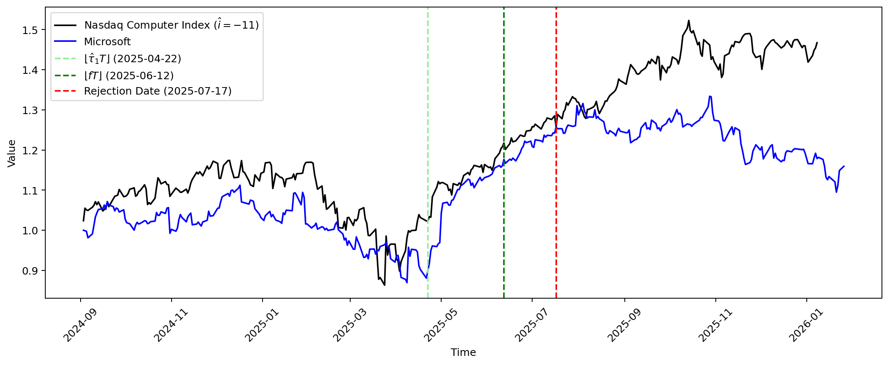

# Recursive Subsample Testing for Co-Explosivity Breakdowns

Python application and empirical data accompanying Taejun Kim's Job Market Paper, *Recursive Subsample Testing for Co-Explosivity Breakdowns*.

The example studies the relationship between the Nasdaq Computer Index (`IXCO`) and Microsoft (`MSFT`) using a recursive, sign-based bubble-detection and co-explosivity breakdown procedure.

## Files

All four files are kept in the repository's top-level directory; no folders or installation as a package are required.

| File | Description |
| --- | --- |
| `application.py` | Original empirical application, including `sBIC`, `sPSY_df`, `sPSY`, `weight_one`, `recursive_residual`, and `recursive_residual2`. |
| `index_vs_msft.csv` | Empirical dataset for the Nasdaq Computer Index and Microsoft. |
| `coexplosivity_application.png` | Figure generated from the empirical application (not simulated data). |
| `README.md` | Instructions and explanation of the empirical illustration. |

## Run the application

Install the dependencies (Python 3):

```bash
pip install numpy pandas matplotlib
```

Open `application.py` in Spyder and press **F5**, or run:

```bash
python application.py
```

Keep `application.py` and `index_vs_msft.csv` in the **same directory**. The script reads the CSV from the script's directory, prints the selected rejection date, displays the figure and saves it as `coexplosivity_application.png`.

## Data and methods

The supplied CSV contains daily observations from **3 September 2024 through 26 January 2026**. The code selects column 6 (`MSFT`) as `y` and column 9 (`IXCO`) as `x`, drops rows with missing or zero prices, and divides each series by its initial nonmissing value. This leaves **350 paired observations**. Consequently, the plotted vertical axis shows *normalised values*, not prices in USD.

The application:

1. Estimates the initial bubble-regime change using `sBIC` applied to the Nasdaq Computer Index.
2. Applies `sPSY` to each series over the prespecified initial sample, using the critical-value threshold **3.213** in the script.
3. Selects a lead/lag offset based on the residual variance criterion and evaluates initial co-bubbling.
4. Computes the recursive co-explosivity statistic and compares it with the time-varying boundary defined in `application.py`.
5. Plots both normalised series with the estimated dates.

The script uses the estimation and critical-value choices specified in the supplied research code; this README does not independently establish the statistical validity of those choices.

## Empirical figure



For the supplied dataset, the script identifies:

| Result | Value |
| --- | --- |
| Initial sBIC break date | 22 April 2025 |
| Recursive testing start date | 12 June 2025 |
| First rejection date | 17 July 2025 |
| Selected lead/lag offset (`d`) | −11 |
| sPSY, Microsoft | 3.3219 |
| sPSY, Nasdaq Computer Index | 3.4341 |

The light-green, dark-green and red dashed lines mark the initial estimated break, the recursive testing start, and the first rejection of the co-explosivity stability criterion, respectively. These dates are outputs of this particular application, not manually inserted historical events.

## Reproducibility note

The Python file retains the supplied econometric routines. For portability, the working directory is set to the folder containing `application.py`; figure saving has been added. A one-line date-indexing correction (`t.iloc[Rejection_data]`) ensures that the printed rejection date agrees with the date used in the figure if missing values were dropped.

This project is research code rather than a general-purpose statistical software package. For questions about the methodological interpretation, see the associated Job Market Paper.
